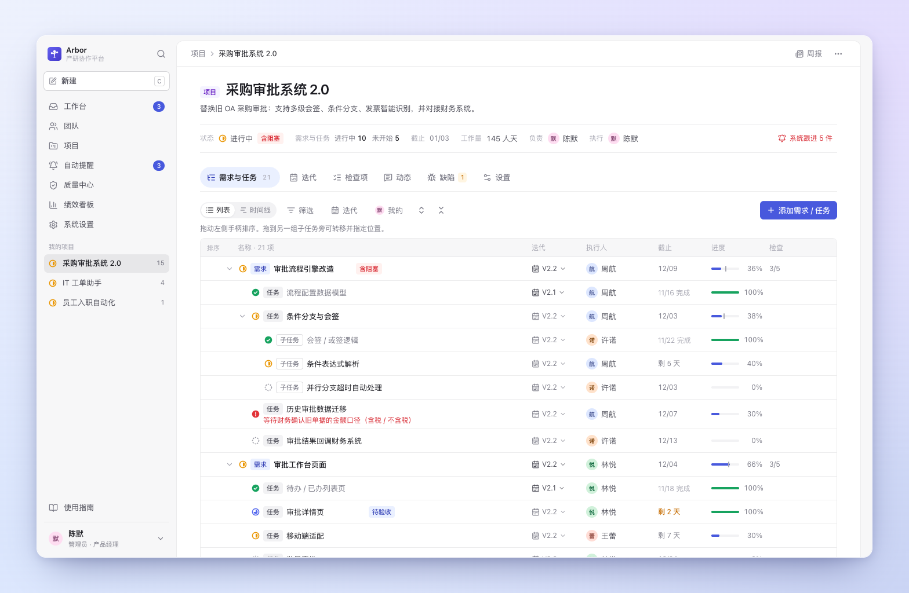
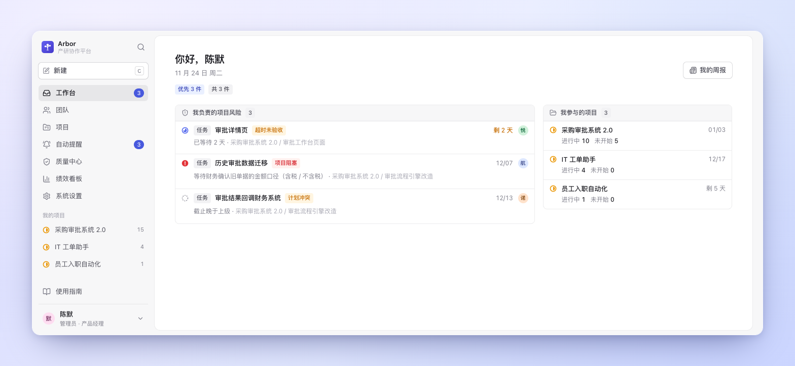

# Arbor

[简体中文](README.md) · English

Arbor is a self-hosted tool for software teams to plan, track, review, and release their work.



## Highlights

- View progress and blockers in the list, timeline, or delivery board.
- Keep deliverables, sign-offs, and requests for changes on the work item.
- Link PRs and MRs and sync supported review and test results.
- Track test sign-off, deployment records, and production verification.
- Record AI evaluation results, inference costs, and failure cases.



Screenshots use built-in demo data. The interface and [user guide](docs/product-spec.md) are in Chinese.

## Quick start with Docker

Install Docker Compose v2 and OpenSSL, then run these commands from the repository.

```sh
sh scripts/setup-compose.sh
docker compose up -d --build --wait
```

1. Open [http://localhost:3000](http://localhost:3000) and select the option to use a setup or invitation code (「使用初始化码或邀请码」).
2. Paste `LOCAL_AUTH_SETUP_TOKEN` from your local `.env` file and choose a display name, username, and password. The setup token works once on an empty account database. You can remove it after setup.
3. Go to **Settings → Members** (「系统设置 → 成员」) to create and share an invitation link privately. Links are single-use and expire after 48 hours. Invitees start with the Member role.

If port 3000 is in use, generate the initial configuration with `APP_PORT=3301 sh scripts/setup-compose.sh`. The application runs database migrations on startup. PostgreSQL data is stored in a persistent Compose volume. For a network deployment, use HTTPS and set `APP_BASE_URL` to the address people will open. See the [self-hosting guide](docs/DEPLOY.md) for reverse proxy, backup, restore, and upgrade instructions.

### Try the demo

Run these commands in a separate copy of the repository. Open [http://localhost:3301](http://localhost:3301) and select a sample account. Arbor seeds the empty demo database when you first open the sign-in page. Keep `DEMO_MODE=false` on production instances.

```sh
APP_PORT=3301 sh scripts/setup-compose.sh demo
docker compose -p arbor-demo up -d --build --wait
```

## Optional integrations

- **Feishu**. Set `FEISHU_APP_ID` and `FEISHU_APP_SECRET` for your Feishu app and register `${APP_BASE_URL}/api/auth/feishu/callback` as the redirect URL. To send reminders, grant the bot permission to send messages, add it to the project chat, and bind the chat in the project settings. Set `RUN_SCHEDULER=true` to enable scheduled reminders.
- **Git repositories**. Select your provider in **Settings → Repositories** (「系统设置 → 代码仓库」), configure its webhook, and bind the repository to a project. Include `AR-<task-id>` in a branch name or a pull or merge request title or description. Set members’ repository usernames so Arbor can match authors and reviewers. [Provider setup](docs/DEPLOY.md#代码仓库)

See [.env.example](.env.example) for configuration options.

## Development and testing

Arbor uses Next.js, React, TypeScript, and PostgreSQL. Use Node.js 22 and PostgreSQL 16. After copying the example environment file, fill in `DATABASE_URL` and `APP_BASE_URL`. To initialize a local administrator, set `LOCAL_AUTH_ENABLED=true` and generate `LOCAL_AUTH_SETUP_TOKEN` with `openssl rand -hex 32`. To seed an empty demo database, set `LOCAL_AUTH_ENABLED=false` and `DEMO_MODE=true`, then run `npm run db:seed:demo` after migration.

```sh
npm ci
cp .env.example .env.local
npm run db:migrate
npm run dev
```

```sh
npx tsc --noEmit
npx eslint src
npm test
npm run test:db
npm run build
```

`npm run test:db` connects to the PostgreSQL server configured by `DATABASE_URL`. The test account needs permission to create a database. Tests create and remove a separate temporary database.

## License

[MIT](LICENSE) · Copyright (c) 2026 nat
