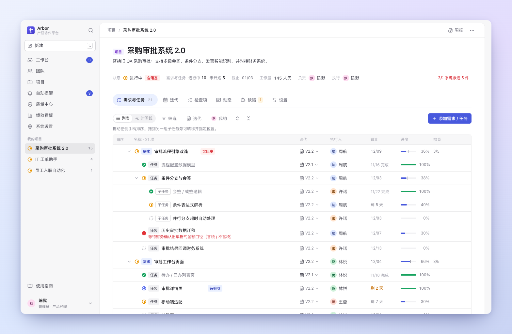
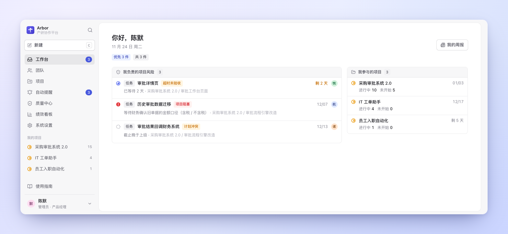

# Arbor

简体中文 · [English](README.en.md)

Arbor 是可自托管的研发交付工具，帮助团队拆解项目、跟踪进度、验收和上线。



## 功能亮点

- 按工作量汇总项目进度，向上显示任务阻塞。
- 在工作项里提交交付物，保留验收和打回记录。
- 关联 PR / MR，同步各平台支持的评审和测试结果。
- 跟踪测试验收、发布登记和线上验收。
- 记录 AI 评测、调用成本和 Bad Case。



截图来自内置演示数据。更多操作见 [使用指南](docs/product-spec.md)。

## Docker 快速开始

安装 Docker Compose v2 和 OpenSSL，在仓库目录运行。

```sh
sh scripts/setup-compose.sh
docker compose up -d --build --wait
```

1. 打开 [http://localhost:3000](http://localhost:3000)，选择「使用初始化码或邀请码」。
2. 将本机 `.env` 里的 `LOCAL_AUTH_SETUP_TOKEN` 粘贴到表单，设置显示名称、用户名和密码。初始化只在空账号库中生效，成功后可删除该令牌。
3. 在「系统设置 → 成员」点击「邀请成员」，将一次性链接私下发给对方。链接 48 小时内有效，受邀者注册后默认是成员。

端口被占用时，首次生成配置可使用 `APP_PORT=3301 sh scripts/setup-compose.sh`。容器启动会自动迁移 PostgreSQL，数据保存在 Compose 持久卷。对外部署请使用 HTTPS，并将 `APP_BASE_URL` 改为实际访问地址。反向代理、备份、恢复和升级见 [自托管部署说明](docs/DEPLOY.md)。

### 体验演示

在独立的仓库副本运行以下命令。打开 [http://localhost:3301](http://localhost:3301) 后可选择示例身份，首次进入登录页时会填充演示空库。正式环境保持 `DEMO_MODE=false`。

```sh
APP_PORT=3301 sh scripts/setup-compose.sh demo
docker compose -p arbor-demo up -d --build --wait
```

## 可选集成

- **飞书**：配置企业自建应用的 `FEISHU_APP_ID`、`FEISHU_APP_SECRET` 和 `${APP_BASE_URL}/api/auth/feishu/callback`。如需消息提醒，给应用机器人开通发消息权限，加入项目群，再到项目设置绑定群。设置 `RUN_SCHEDULER=true` 后才会运行定时提醒。
- **代码仓库**：在「系统设置 → 代码仓库」选择平台，按页面提示配置 Webhook，再到项目详情绑定仓库。分支名、PR / MR 标题或描述带 `AR-<任务编号>` 即可关联任务。到「系统设置 → 成员」登记仓库用户名，帮助匹配提交人和评审人。 [各平台配置](docs/DEPLOY.md#代码仓库)

环境变量见 [.env.example](.env.example)。

## 本地开发与测试

项目使用 Next.js、React、TypeScript 和 PostgreSQL。需要 Node.js 22 和 PostgreSQL 16。复制配置后，先填写 `DATABASE_URL` 和 `APP_BASE_URL`。本地账号初始化需设置 `LOCAL_AUTH_ENABLED=true`，并用 `openssl rand -hex 32` 生成 `LOCAL_AUTH_SETUP_TOKEN`。如需用空库体验演示，将 `LOCAL_AUTH_ENABLED` 设为 `false`、`DEMO_MODE` 设为 `true`，迁移后运行 `npm run db:seed:demo`。

```sh
npm ci
cp .env.example .env.local
npm run db:migrate
npm run dev
```

```sh
npx tsc --noEmit
npx eslint src
npm test
npm run test:db
npm run build
```

`npm run test:db` 使用 `DATABASE_URL` 对应的 PostgreSQL，测试账号需有建库权限。用例会创建并清理独立的临时数据库。

## 许可证

[MIT](LICENSE) · Copyright (c) 2026 nat
